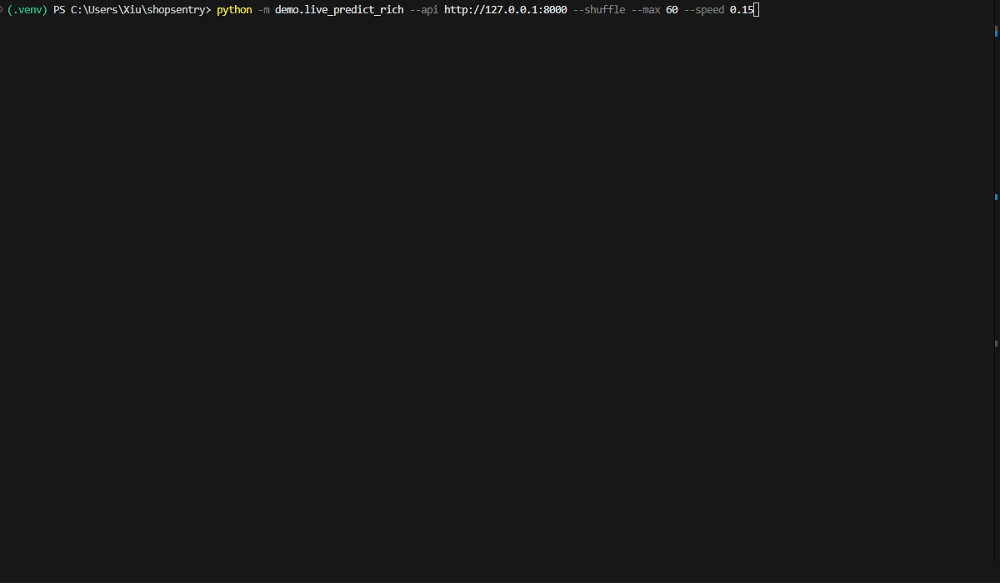

# ShopSentry



*Sessions streaming through the served model. The demo replays sessions the model was trained on, so it shows the system working end to end. See [Results](#results) for held-out numbers.*

## What is it
A real-time anomaly detector for simulated e-commerce traffic. It flags bot traffic and fraud rings using a full ML pipeline: simulated traffic → streaming feature engineering → model training and comparison → a served model with monitoring.

## What this project shows
- **End-to-end ML system, not just a notebook.** Event simulation, a streaming feature pipeline, experiment tracking, a model registry, real-time serving, monitoring, integration tests, and load testing.
- **Honest evaluation without labels.** Compares labeling strategies for when you don't have ground truth, scores every one against held-out true labels, and documents where each one fails.
- **Data quality fixes, found by auditing my own pipeline.** 27% of training rows were partial duplicates from Spark, and my "unsupervised" model was quietly using labels. Both are fixed and written up below.
- **Production-style serving.** FastAPI with Pydantic validation, MLflow Registry version pinning, Feast online lookup with fallback, and Prometheus metrics.
- **Measured performance under load.** Distributed Locust tests across two machines, with latency at different levels of traffic.

## Architecture

```
┌──────────────┐    Kafka     ┌──────────┐   Streaming   ┌─────────────────┐
│  Simulator   │─────────────▶│ Redpanda │──────────────▶│  Spark          │
│ (4 agent     │              │          │               │  feature engine │
│  types)      │              └──────────┘               └────────┬────────┘
└──────────────┘                                                  │
                                                                  ▼
                                                          ┌──────────────┐
                                                          │     Feast    │
                                                          │ (Redis +     │
                                                          │  Parquet)    │
                                                          └──────┬───────┘
                                                                 │
                              ┌──────────────────────────────────┤
                              │                                  │
                              ▼                                  ▼
                       ┌─────────────┐                  ┌────────────────┐
                       │ Training    │                  │  FastAPI       │
                       │ pipeline    │   MLflow         │  /predict/     │
                       │             │──Registry───────▶│  anomaly       │
                       └─────────────┘                  │                │
                                                        │  Prometheus    │
                                                        │  /metrics      │
                                                        └────────────────┘
```

## Results

**Setup:** 7,169 sessions after removing duplicates, 16% true anomaly rate (bots + fraud rings), 9 session-level features. Each labeler makes its own labels, XGBoost trains on those labels, and the score is against the **true** labels on a held-out 30% test split.

### Model comparison

| Labeler | Uses labels? | Label F1 | XGBoost F1 (test) | Bot recall | Fraud recall |
|---|---|---|---|---|---|
| Isolation Forest | No | 0.39 | 0.44 | 69% | 28% |
| Autoencoder, label-free | No | 0.02 | 0.02 | 0% | 2% |
| **Autoencoder, 500 verified normals** | **Small trusted sample** | **0.89** | **0.88** | **100%** | **100%** |
| Heuristic rules | Thresholds picked from the data | 1.00 | 1.00 | 100% | 100% |
| Oracle (true labels) | Yes, all | 1.00 | 1.00 | 100% | 100% |

**Served model:** XGBoost trained on labels from the autoencoder with 500 verified-normal sessions (registry v7).

### How many verified sessions does it need?

Run 5 times per size, each with a different random sample (`sweep_verified.py`):

| Verified normals | F1 min | F1 avg | F1 max |
|---|---|---|---|
| 50 | 0.00 | 0.59 | 0.94 |
| 100 | 0.76 | 0.87 | 0.93 |
| 200 | 0.75 | 0.83 | 0.87 |
| 500 | 0.83 | 0.88 | 0.90 |

Below 100, results swing from total failure to great depending on which sessions get picked. At 500 (about 8% of normal sessions), it's stable.

**Why F1 tops out around 0.88:** recall is 100%, every bot and fraud session gets caught. The misses are false alarms. The threshold flags the 5% most unusual normal sessions by design, which keeps precision around 0.8. I didn't tune the threshold, because picking it by looking at test results would be using the answers.

### What I found and fixed

**1. 27% of training rows were duplicates.** Spark groups events by session in `update` mode, so it re-sends a session every batch it gets new clicks, and each batch was saved to its own Parquet file. Long sessions (bots) got saved several times, mostly as unfinished copies, and copies could land in both train and test. The loader now keeps only the latest copy of each session (9,866 → 7,169 rows). Redis didn't have this problem because it overwrites by key.

**2. The "unsupervised" autoencoder was using labels.** It trained only on rows marked normal, which you can't do without labels. Trained on everything instead, it collapses to F1 = 0.02. The reason: bots and fraud rings behave almost identically session to session, so they form tight clusters that are *easy* to reconstruct. The autoencoder ends up flagging unusual normal users and letting bots through. DBSCAN failed the same way, which points at the data shape, not a bug.

**3. Rebuilt as semi-supervised.** Real companies don't know which sessions are fraud, but they do have customers they trust. The autoencoder now trains on a small verified-normal sample (500), which matches how this works in practice.

### API latency under load

Distributed test: Locust on macOS hitting FastAPI on Windows over LAN, 16 uvicorn workers, 0 failures across 30K+ requests.

| Concurrent users | p50 | p95 | p99 | RPS |
|---|---|---|---|---|
| 20 | 32 ms | 88 ms | 160 ms | ~190 |
| 30 | 60 ms | 150 ms | 240 ms | ~240 |
| 50 | 83 ms | 190 ms | 260 ms | ~295 |

Direct measurement (no load): ~3 ms p50. Above about 30 concurrent users, time spent waiting in line becomes larger than the actual work. In production, scaling out (Kubernetes, AWS EKS) would handle this.

## Quick Start
### Prerequisites
- Docker Desktop running
- Python 3.12+
- 4GB free RAM

### 1. Bring up infrastructure
```bash
.venv\Scripts\activate
docker compose up -d
# Starts: MLflow, Redis, Redpanda, Spark
```

### 2. Generate training data
```bash
# Terminal 1: streaming feature engine
python -m pipeline.spark_streaming

# Terminal 2: traffic simulator
python -m simulator.run --scenario mixed_large
```

Wait 2 minutes for Spark to drain.

### 3. Train and register the model
```bash
python -m models.run_pipeline --labelers autoencoder --skip-oracle
```

In the MLflow UI (http://localhost:5000), open the `xgb_on_autoencoder` run and register `xgboost` as `shopsentry_classifier` and `scaler` as `shopsentry_scaler`. Set the matching version in `api/model_loader.py`.

### 4. Serve predictions
```bash
uvicorn api.main:app --port 8000 --workers 8
```

API docs at http://127.0.0.1:8000/docs

### 5. Live demo
```bash
python -m demo.live_predict_rich --api http://127.0.0.1:8000 --shuffle --max 120 --speed 0.06
```

On Windows, use `127.0.0.1` rather than `localhost`. `localhost` tries IPv6 first and adds about 2 seconds to every request.

### 6. Test
```bash
make test          # 30+ unit and integration tests
make load-test     # Locust against local API
```

## Folders tree

```
shopsentry/
├── api/                    # FastAPI service (predict, health, metrics)
│   ├── main.py
│   ├── model_loader.py     # MLflow Registry client
│   ├── feast_client.py     # Online feature lookup with fallback
│   ├── observability.py    # Prometheus metrics + /health
│   └── schemas.py          # Pydantic request/response
├── models/                 # ML pipeline
│   ├── data_loader.py      # Loads + dedupes offline features
│   ├── pseudo_labelers/    # Labeling strategies + ensemble
│   ├── classifiers/        # XGBoost wrapper
│   └── run_pipeline.py     # Orchestrator
├── pipeline/               # Spark streaming feature engine
├── simulator/              # 4 agent types (normal, bot, fraud ring, churning)
├── feature_repo/           # Feast definitions
├── demo/                   # Live terminal dashboard
├── load_tests/             # Locust scenarios
├── tests/
│   ├── unit/
│   └── integration/        # Mocked, runs without infra
├── sweep_verified.py       # How many verified sessions the autoencoder needs
└── docs/
    └── model_comparison.md # Earlier model analysis
```

## Tech stack

- **Streaming:** Redpanda (Kafka), Spark Structured Streaming
- **Feature store:** Feast (Redis online + Parquet offline)
- **Models:** XGBoost, TensorFlow autoencoder, scikit-learn (IsolationForest, StandardScaler)
- **Experiment tracking:** MLflow (server, registry, model logging)
- **Serving:** FastAPI + Uvicorn workers
- **Validation:** Pydantic v2
- **Observability:** Prometheus client (counters, histograms, gauges)
- **Testing:** pytest + TestClient + mocks
- **Load testing:** Locust (distributed master/worker)
- **Demo:** rich (live terminal dashboard)
- **Quality gates:** ruff, mypy, GitHub Actions CI

## Limitations

This is phase 1. The simulated attackers are obvious, which makes detection easier than real fraud:

- Bots make 50 to 120 events per minute, consistently.
- Fraud rings check out within seconds, every time.
- Heuristic rules tie the oracle at F1 = 1.00 only because I picked their thresholds while looking at this data.
- All features describe one session alone. Fraud rings are a group behavior (shared IP subnet, same product, same minute), and nothing in the features captures that yet.
- The Spark job still writes duplicate session rows. The loader removes them, but the real fix is writing each session once (a session window, or upserts with Delta Lake).

## What's next

1. **Phase 2: evasive agents.** Bots that throttle below detection thresholds, fraud rings that browse normally before buying. Every model's score should drop, which is the point.
2. **Group features.** Sessions per IP subnet, sessions buying the same product in the same few minutes. These should catch fraud rings no matter which model is used.
3. **Containerize and deploy the API** with the model files baked in.

## Read more

- [docs/model_comparison.md](docs/model_comparison.md): earlier analysis of each labeler, before the fixes above
- API docs are auto-generated at `/docs` when uvicorn is running

---

Built by Anh Tong | [LinkedIn](https://www.linkedin.com/in/anhtongxt/) | anhtongxt@gmail.com